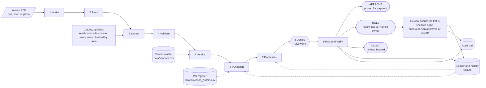
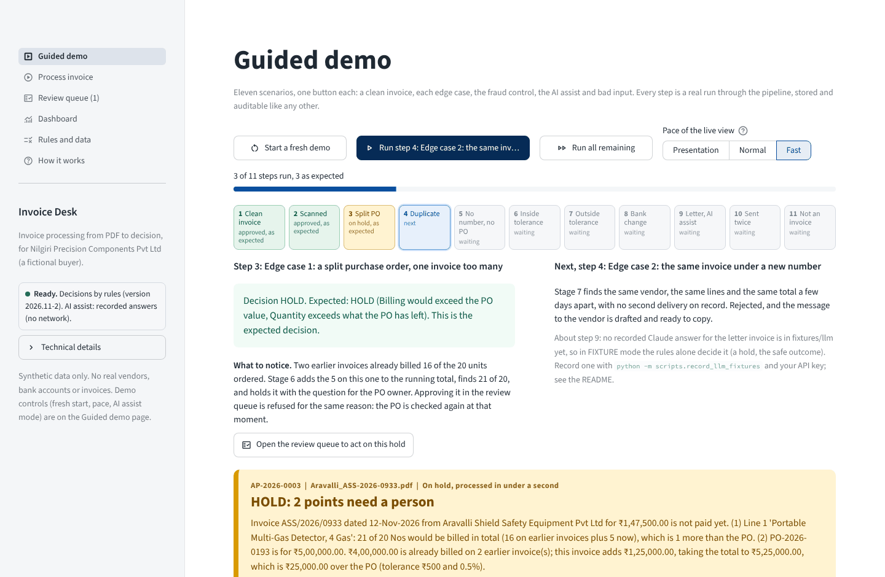
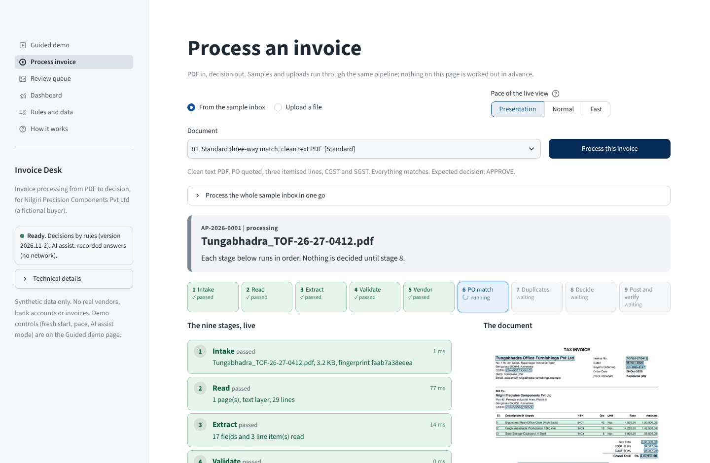
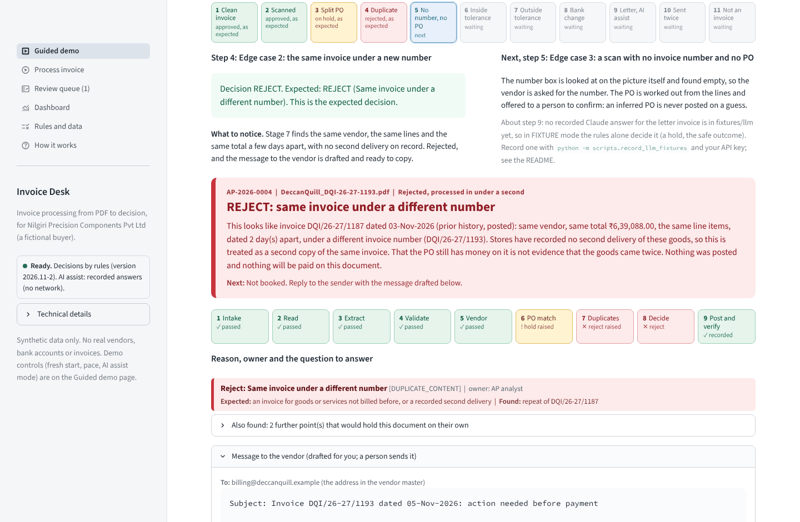
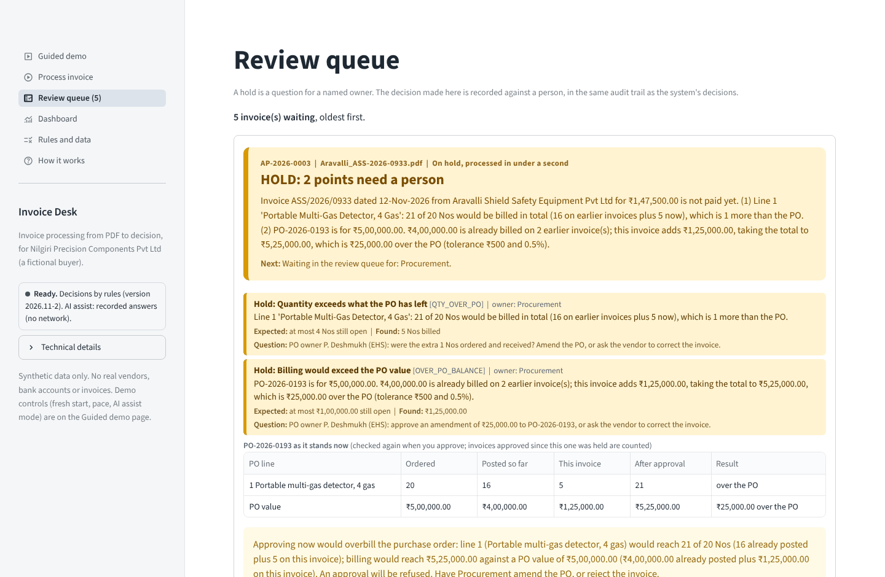
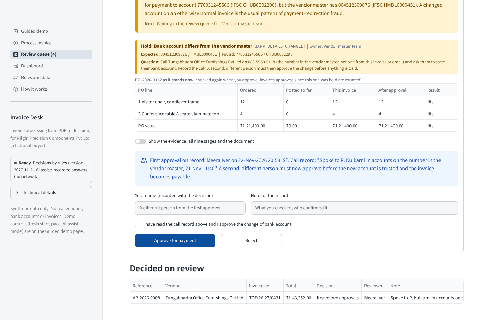
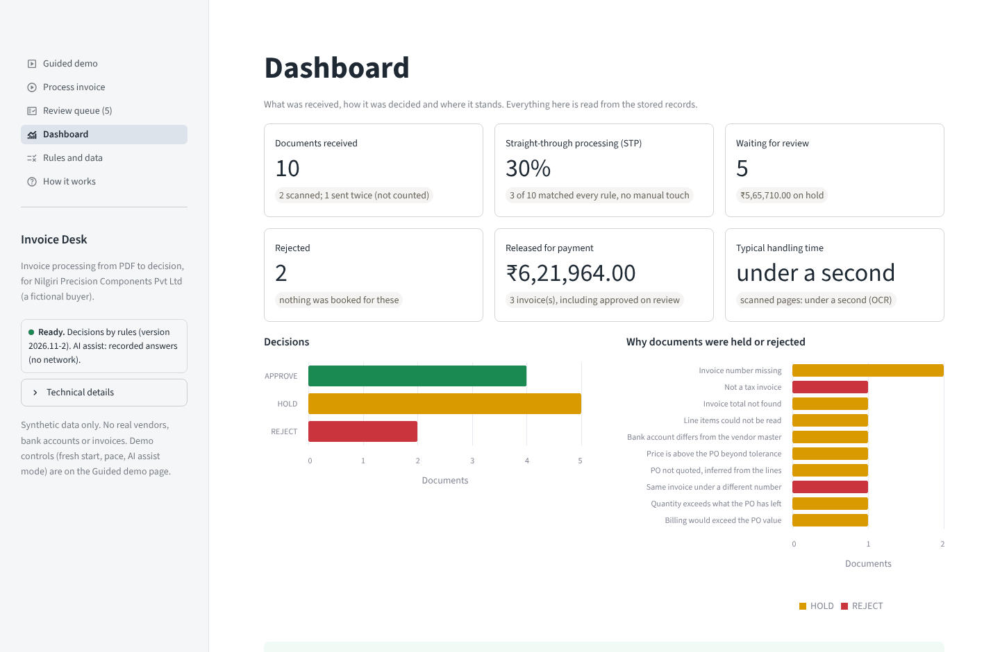

# Invoice Desk

**Invoice processing, from PDF to decision.** Problem statement 1 of the AI Solutions
Analyst case study.

A vendor invoice goes in as a PDF: typed, scanned or photographed. A decision comes out:
**Cleared** for payment, **On hold** for a named person with one specific question, or
**Rejected**. Every step in between is on screen with the evidence it used, and every
decision leaves an entry in an audit trail that cannot be edited afterwards without it
showing.

> All data in this project is synthetic. The buyer (Nilgiri Precision Components Pvt
> Ltd), the vendors, the GSTINs, the bank accounts and the invoices are fictional, and
> every PDF says so in its footer.

**Live link:** to be added after deployment. **Video:** to be added after recording. The
free host puts an app to sleep after 12 hours without visitors; if you see a sleep
screen, press the button to wake it and give it about a minute.

## Run it

```powershell
py -3.11 -m venv .venv
.venv\Scripts\python -m pip install -r requirements.txt
.venv\Scripts\python -m streamlit run app.py
```

Then open <http://localhost:8501>. The first page is the **Guided demo**: press "Watch one
invoice go from PDF to decision", or "Run step 1". On macOS or Linux use `.venv/bin/python`. The full Windows walkthrough (tests,
the OCR engine, the Claude key, recording, free public hosting, the demo-day checklist)
is in [SETUP_WINDOWS.md](SETUP_WINDOWS.md).

Four commands worth knowing:

```powershell
.venv\Scripts\python -m pytest -q -p no:cacheprovider        # the full suite (count in PROGRESS.md)
.venv\Scripts\python -m scripts.preflight                   # is this machine ready for the demo?
.venv\Scripts\python -m invoice_desk.run --all              # every sample from the command line
.venv\Scripts\python -m invoice_desk.run --cases            # the two after-hold samples (steps 12 and 13)
.venv\Scripts\python -m scripts.evaluate_robustness         # the independent test set (section "How I know it works")
.venv\Scripts\python -m scripts.benchmark_throughput --n 200   # invoices an hour on this machine
```

No API key, no account and no network are needed to run it. Nothing on the critical
path depends on a paid service being up.

## The problem, in one paragraph

An AP team gets hundreds of invoices a month as PDFs. Someone opens each one, finds the
purchase order in a spreadsheet, checks the numbers and decides what to do. The
invoices are messy: every vendor formats them differently, some are scans, tax may be
inside the prices or separate, the PO may be quoted or only implied, and sometimes the
invoice number is simply missing. The expensive mistakes are the quiet ones: paying
twice, paying more than was ordered, paying into the wrong bank account.

## What the process does



| # | Stage | What it does | What it leaves on screen |
|---|---|---|---|
| 1 | Intake | Registers the file and fingerprints it. A file already on record gets its first answer back and is booked once | File, size, fingerprint, time received |
| 2 | Read | Gets the words off the page: the text layer, or OCR. A scan is read twice; a photograph is cropped, straightened and evenly lit first | Per page: how it was read, what was corrected, OCR confidence |
| 3 | Extract | Finds header fields and line items, each with where it was read. If the rules cannot read the document, Claude may fill the gaps, and code checks every value against the page | Every field with value, confidence and source; for scans, the two reads side by side |
| 4 | Validate | Checks the invoice against itself: required fields, arithmetic, GST, dates | 14 named checks, each pass or fail with the figures |
| 5 | Vendor | Identifies the vendor by GSTIN and compares the bank account with the master | Who matched and how; master account against invoice account |
| 6 | PO match | Finds the PO, compares line by line with tolerances, counts what earlier invoices used up | Line-by-line comparison; the running total on the PO, invoice by invoice |
| 7 | Duplicates | Looks for the same invoice already on record, in any disguise | Three checks and what each found |
| 8 | Decide | Applies `rules.yaml` to everything found | Each finding, its action, its owner |
| 9 | Post and verify | Writes ledger, audit entry and record in one transaction, then reads the ledger back | Ledger entry, read-back result, audit entry |

## What is on screen

Eleven pages in four groups in the sidebar: **See it work** (Guided demo, Process invoice),
**Work the desk** (Inbox, Cases, Review queue, Payments), **Results** (Dashboard, Business
case) and **Reference** (Rules and data, Procedure, How it works). Every screen uses the
same words: Cleared, On hold, Rejected; the same nine step names; ₹ for money; and one
date format (21-Nov-2026, with the time as 21-Nov-2026 14:05). The business date is
21-Nov-2026 with the real time of day. Reason codes appear only under "Reason code (for
auditors)", and no screen names the AI model (it stays in the stored record).

- **Guided demo.** Eleven scenarios, one button each: a clean invoice, a scan, the four
  edge cases, the bank-change control, the AI assist, the same file sent twice, and
  something that is not an invoice. Each is a real run, compared with its expected
  decision after the fact. "Try your own invoice" takes an upload through the same
  stages. The demo controls live here: fresh start, pace of the live view, AI mode.
- **Process invoice.** Pick a sample or upload a PDF. The nine stages run one after
  another, each with its one-line result, its timing and any finding it raised. The
  document sits beside them with a box around every value that was read. The decision
  appears on top with its reasons, the owner of each, the question to answer, and a
  message to the vendor that is ready to copy when the vendor has to act.
- **Review queue.** Invoices on hold, oldest first. Each shows its question and the
  purchase order as it stands now. A named person approves or rejects. An approval that
  would overbill the PO is refused with the numbers. A changed bank account takes two
  different people.
- **Dashboard.** Five numbers (cleared with no person, on hold now, days to clear a hold,
  money stopped, legal dates at risk), three charts, what needs attention, the audit-trail
  check, and every invoice with its full record.
- **Inbox, Cases, Payments, Procedure.** The day's mail sorted with an owner for each
  message (one row per email); every hold as a case with one question and a due date; the
  payment-run proposal with one or two named approvals depending on the amount; and rule
  changes tested against past invoices before anyone approves them.
- **Business case.** One sentence, three numbers, the assumptions with where each comes
  from, two bars and what is not counted. Its invoice, on-hold and per-owner counts come
  from the same query as the Dashboard.
- **Rules and data.** The limits as sentences, the reasons (codes behind an auditors'
  expander), vendors and POs, "Try a change" (one sample both ways, or all samples
  replayed), and the ledger.
- **How it works.** AI reads, rules decide, people approve; the nine steps; how well it
  reads; what it does not do.

| Guided demo: three steps done | A run in progress |
|---|---|
|  |  |
| **A rejection, its reason and the message to the vendor** | **Review queue: the PO as it stands now** |
|  |  |
| **Bank change: first approval recorded, second person needed** | **Dashboard** |
|  |  |

## After a hold

A hold is not the end of the job. Every held invoice becomes a **case** on the Cases page,
with one owner, one question, an answer date from `rules.yaml` (`cases.reply_due_days`)
and a history of everything that happened to it. When the answer date passes, the case is
escalated once to the role named in `cases.escalate_to`.

- **Step 12, the invoice that arrives before the goods.** It is held for Stores and for
  nothing else. When Stores record the delivery on the case, the desk re-checks the
  purchase order exactly as a person's approval would and, if nothing else was holding
  it, releases the invoice and posts it. This is recorded as **released by rule**, never
  as approved, with the goods receipt and the release in the audit trail. It happens only
  when every reason on the hold is listed in `cases.auto_resume`; set
  `auto_resume: []` and the desk never releases anything by itself.
- **Step 13, a small supplier near the legal pay-by date.** The vendor is a registered
  small enterprise, so the MSMED Act gives at most 45 days from acceptance of the goods.
  The case shows that date, the days left and a rough interest figure, is marked urgent
  and escalated to the Finance controller at once. The drafted message to the vendor goes
  nowhere until a named person approves it. "Send" means the email is written to an
  outbox folder and recorded; no mail server is connected.

Opening, closing and escalating a case are bookkeeping and stay out of the audit chain,
so the first eleven steps give exactly the same receipts as before. `cases.enabled: false`
switches the whole desk off.

## Business case

The Business case page shows what the invoices in these books show (share passed
untouched, money stopped as duplicates or held for overbilling or a bank change, holds by
owner, AI cost per invoice), then a calculator. Every input of the calculator is an
assumption kept in `rules.yaml` (`value_model`) and shown with its source; the formula is
printed under the result. With the defaults handling drops from 17.0 to 6.56 minutes an
invoice, about 104 hours and ₹46,980 a month, before the cost of running the desk. Time
spent chasing exceptions is left the same before and after, because that is not measured.

## Rolling it out

Week one, nothing is approved without a person: set the auto-approval ceiling
(`auto_approve.max_invoice_total_inr`) below every real invoice (the Rules and data
sandbox shows the effect at Rs 1,000) and compare the desk's decisions with the team's.
Raise the ceiling by vendor group as the two agree, and switch on release by rule last.

## How a decision is made

Stages 4 to 7 do not decide anything. They produce **findings**: a code, what was
expected, what was found, the evidence, and the question it raises. Stage 8 looks each
code up in [`rules.yaml`](rules.yaml), which says whether that finding rejects, holds
or is only noted, and who owns it. The strictest action wins.

```
decision = decide(findings, rules)        # no file, no database, no clock, no model
```

`decide()` is a pure function, so the same findings and the same rules always give the
same decision. Every threshold is in the rules file, none in code, and each is tested
from both sides. The file's hash is written into every audit entry.

What "the same answer" covers, precisely: the same file, rules, master data, business
date and recorded AI answers give the same record, on any machine. The same file sent
again returns the first record.

| Rule | Default | Why |
|---|---|---|
| Unit price over the PO | passes only inside **both** 1% and Rs 500 on the line | A percentage alone lets a large line drift by thousands; a rupee limit alone lets a small line double |
| Quantity over the PO | not allowed, counting what earlier invoices billed | This is what catches a split PO being over-billed |
| Cumulative billing over the PO value | passes only inside both 0.5% and Rs 500 | Same reason, at PO level |
| Approval from the review queue | the PO is checked again at that moment; no override | Two holds can each fit the PO and overbill it together |
| Invoice arithmetic | may be off by Rs 1 | Rounding |
| Clean invoice above Rs 10,00,000 | held for the finance controller | A simple delegation of authority |
| Same invoice number as a booked invoice | reject | Nothing can be owed twice |
| Same vendor, lines and total under a new number within 15 days | reject, unless goods receipts show a second delivery | Room left on the PO is not evidence that goods came twice |
| Same file again | the first answer is returned; nothing is booked twice | A re-send is not a new invoice, and not a fraud either |
| Bank account differs from the vendor master | hold; two different people must approve, the first after a call-back | The classic payment-redirection pattern |
| PO not quoted on the invoice | the best-fitting PO is suggested and a person confirms | Posting against the wrong PO corrupts its balance for every later invoice |

The explanation, the question and the message to the vendor are templates filled with
the evidence, so they are the same word for word every time.

## The four edge cases

Each comes from a difficulty the brief names, and each ends differently.

| | Sample | What happens | Decision |
|---|---|---|---|
| **1** Split PO, one invoice too many | `04_E1_split_po_overbilling` | The PO is for 20 gas detectors and Rs 5,00,000. Two earlier invoices billed 16. This one bills 5 more. Nothing is wrong with the invoice on its own; only the running total shows it. | **HOLD**: 21 of 20, Rs 25,000 over, with a question for the PO owner. Approving it from the queue is refused for the same reason |
| **2** The same invoice under a new number | `05_E2_disguised_duplicate` | Same vendor, lines and amount as an invoice booked two days earlier, under a new invoice number. A check on the number alone would pay it twice. The PO still has room, and no second delivery has arrived. | **REJECT**, pointing at the original, with the message to the vendor drafted |
| **3** Scan, number missing, PO implied | `06_E3_scan_no_number_implied_po` | A tilted, noisy scan with no text layer. The invoice number box is blank and no PO is quoted. | **HOLD**: the box is checked on the picture and found empty, so the vendor is asked; the PO is inferred with its score and a person confirms |
| **4** Tax inside the prices, at the tolerance | `07_E4a...` and `08_E4b...` | Prices include GST; the PO is before tax. After conversion one is 0.95% and Rs 488 over on the line, the other 1.01% and Rs 515. The printed prices differ by two rupees. | **APPROVE** with a note on one side, **HOLD** for the price alone on the other |

Also handled, with samples or tests: a changed bank account
(`09_fraud_guard_bank_change`), an invoice written as a letter
(`10_ai_assist_letter_invoice`), quotations and unrelated PDFs, corrupt, empty,
truncated and password-protected files, a file with too many pages, item tables that run
over several pages, a foreign-currency invoice, a credit note, a corrected copy of an
invoice that is still on hold, billing ahead of goods receipt, a lump-sum invoice
against an itemised PO, two invoice lines for one PO line, an unknown or blocked vendor,
and an invoice whose own figures do not add up.

## Where AI is used, and where it is not

The guide says to use AI tools deliberately. This is the deliberate part.

**The decision uses no model.** Approve, hold or reject comes from findings and a rules
file, so it is the same tomorrow and can be explained line by line.

**Claude has two jobs** ([`invoice_desk/llm.py`](invoice_desk/llm.py), DECISIONS.md D45
to D49, D63, D64):

1. **Reading what rules cannot.** Sample 10 is an invoice written as a letter: no table,
   no labels. The rules reader does not guess, so on its own it holds the invoice. With
   AI assist, Claude returns the fields as strict JSON, each value copied from the page
   with the sentence it came from. Code then checks that the sentence is on the page
   character for character, that the value is a whole token inside it, that a number
   stands beside words saying what it is, and that the invoice's arithmetic agrees. A
   value that fails is not used. A value the rules already read is never overwritten.
   The model does not calculate, does not see the PO register and takes no part in the
   decision. Its own confidence can lower trust and never raise it. On the document,
   what Claude read is outlined in its own colour, at the place code found it.
2. **Rewording the message to a vendor**, on request. Code checks that the rewording
   adds no figure, date or reference and keeps the invoice number, the PO and the total.
   Otherwise the draft stands. A person sends it either way.

**Three modes**, shown in the sidebar on every page:

| Mode | What it does | Needs |
|---|---|---|
| FIXTURE (default) | Replays answers recorded earlier. No network | Nothing |
| CACHED-LIVE | Calls the Claude API only when no stored answer exists for that file, prompt version and model, then keeps the answer | `ANTHROPIC_API_KEY` |
| OFF | Rules only | Nothing |

A key on its own changes nothing. Calls are bounded by a timeout, a retry count, a cap
per invoice and a cap per day. If the API refuses, times out or returns something
unusable, the run carries on with the rules alone and says why.

Once an answer is stored, live mode reuses it, so a rehearsed demo makes no call at
all. To show a real one, the demo settings have a switch, "Ask Claude afresh on every
run". If that call fails, the stored answer is used and the record says so.

**State of this package:** no recorded answer ships. The build environment cannot reach
the API, and an answer written by hand would be a fake. Recording is one command with
your key (`python -m scripts.record_llm_fixtures`, SETUP_WINDOWS.md step 6). Until then
sample 10 is held by the rules, and the screen says so. Everything around the call is
tested with the real SDK and a fake transport, including every failure, and the state
after recording was rehearsed end to end with stand-in answers that were then deleted.
What no test here can show is how the real model answers.

Uses I rejected, with reasons in D49: a model that decides or advises the decision, a
model-written summary of the decision, the model's confidence as a reason to approve,
model-based duplicate detection, and chat with your invoices.

## How the reading works

- **Text PDFs** are read from their text layer with positions. Fields are found by
  label vocabulary and page geometry, not by per-vendor templates. Line items are read
  by column, and arithmetic is the cross-check: quantity times price must equal the
  amount, the lines must sum to the taxable value, taxable plus tax must equal the
  total, and the amount in words must agree with the figures. When a page prints
  several totals, the one the arithmetic confirms is the invoice total.
- **Scans** are straightened, cut into blocks and read with Tesseract, **twice**. The
  read whose figures add up is used. A value no arithmetic can confirm, such as the
  invoice number or the date, is trusted only when both reads agree.
- **Photographs** are cropped to the sheet, the perspective is undone, uneven light is
  divided out, and a page lying on its side is turned, before the two reads.
- **Missing stays missing.** A field that cannot be read is empty with a reason. There
  are no defaults and no nearest guesses.

## How I know it works

- **How sure.** Every figure carries its sample size and a Wilson 95% interval. No
  wrong approval in 49 outside documents is still consistent with a true rate of up to
  7.3%; showing under 1% would take about 381 documents. Values read as printed: 691 of
  705 with Tesseract 5.4.0 on my machine. See "How sure can we be" in
  [docs/robustness_report.md](docs/robustness_report.md).
- **Speed.** 200 text invoices in about 15 seconds on one process, median 69 ms each
  ([docs/throughput.md](docs/throughput.md)). Scans take seconds a page.
- **Tests.** 625 automated tests: every rule from both sides of its threshold; the pure
  decision function, including a check that adding a problem can never make the outcome
  more lenient; the audit trail (an edit, a forged entry and a deletion are each
  detected); every sample end to end; every bug the audit found, reproduced first; bad
  inputs that must fail gracefully (corrupt, empty, truncated, password-protected,
  oversized, 25 pages, random bytes); the Claude layer through the real SDK with a fake
  transport; and every page of the UI driven headlessly, including the guided demo.
- **An independent audit.** Round 1 was audited on a Windows laptop and walked through
  in a browser. Both reports are in [`docs/`](docs/). Every finding is answered in
  [CHANGELOG.md](CHANGELOG.md).
- **An independent test set.** The audit's fair objection was that my scorecard used
  invoices from my own generator. So [`robustness/`](robustness/) holds 49 documents
  made with other tools (headless Chrome, wkhtmltopdf, LibreOffice Calc and Writer,
  LaTeX) in the layouts Indian accounting packages print, plus 12 photographs of printed
  pages. 34 should be approved and 15 should be stopped, for eleven different reasons.
  The report is [`docs/robustness_report.md`](docs/robustness_report.md).

  | | Documents | Right answer | Held without reaching it | Approved wrongly |
  |---|---|---|---|---|
  | Before any change to the reader | 49 | 13 | 36 | **0** |
  | After | 49 | 45 | 4 | **0** |
  | of which: text PDFs never opened while building | 12 | 12 (6 before) | 0 | **0** |
  | of which: photographs never opened while building | 5 | 3 | 2 | **0** |

  The four that still fail are photographs. In the two I could examine, one of the two
  reads got a single character wrong (an invoice number, a date), the reads disagreed,
  and the invoice went to a person. That is the check working, and I did not add a rule
  to guess. The other two are in the part of the set I kept unopened; the report shows
  they were held because values could not be read. "Approved wrongly" is the number that
  costs money. It is zero on these documents; that is a result for these documents and
  not a guarantee.
- **The older scorecard**, on unseen layouts from the samples' own generator
  ([`docs/extraction_scorecard.md`](docs/extraction_scorecard.md)): 200 of 200 text PDFs
  approved untouched; of 96 scans, 86 approved untouched, 6 read correctly and held,
  4 misread and held, none misread and approved.
- **A preflight.** `python -m scripts.preflight` checks the machine, runs every sample
  through the real pipeline, rehearses the eleven demo steps and opens every page.

## What was verified, and what was not

| Verified | Not verified |
|---|---|
| Clean unzip, fresh install, full test suite on Linux (Python 3.11, 3.12 and 3.13) | Windows for this round. Round 1 was verified on Windows 11 by the audit; this round's code was not run there |
| All 18 samples from the command line and through the UI | A live Claude call, and a recording made from one |
| Every page in a real Chrome browser, with the screenshots above taken from it | Deployment to a public host |
| Live OCR with Tesseract 5.3.4, and the recorded-OCR fallback | The Dockerfile (written, not built: the base image could not be pulled) |
| The independent test set, with recorded and with live OCR | Real invoices from real vendors |

SETUP_WINDOWS.md turns the right-hand column into steps.

## Limits

- Built for Indian GST tax invoices in English and rupees, one purchase order per
  invoice. A foreign-currency invoice is read and handed to a person.
- **Your own invoice will be held, and that is correct.** The vendor list and the PO
  register are made up. An invoice from a vendor that is not on the list, or with no PO
  in the register, is held for exactly that reason, with the evidence.
- An invoice with no table at all (sample 10) needs the AI assist, which needs a
  recording or a key.
- Photographs are the weak spot: 8 of 12 in the independent set reached the right
  answer. The other 4 went to a person; none was approved wrongly.
- An invoice number that both reads of a scan get wrong in the same way would pass. In
  production I would check it against the e-invoice IRN.
- Reviewer names are typed, because the demo has no login. "Two different people" is
  enforced on the names; in a deployment the name comes from single sign-on.
- The audit trail shows any edit to a past entry. Someone able to rewrite the whole
  database could rebuild it, unless `RECEIPT_SIGNING_KEY` is set.
- Tolerances and the Rs 1 rounding allowance are example policy, not advice.
- The vendor master and PO register are CSV files, and the ledger is a local SQLite
  file. No mailbox is connected: the upload box stands in for the email attachment.
- "Send" on a case writes the email to an outbox folder and records it. No mail server
  or ERP is connected.
- The legal pay-by date is approximate when no delivery date is on record: it is then
  counted from the invoice date, and the case says so.
- The business case does not claim any saving on time spent chasing exceptions.
- Reading a vendor's reply with AI and intake from `.eml` files are specified but not
  built.

## What I would build next

1. **Mailbox intake**: poll an AP inbox, take each PDF attachment, reply from the
   drafted vendor message after a person approves the wording.
2. **E-invoice checks**: read the IRN and QR code and verify them against the
   government portal, which makes the invoice number and total independent of OCR.
3. **Single sign-on and an approval matrix** by amount and department, in place of typed
   names and one ceiling.
4. **Credit and debit notes** applied to the invoice they refer to; invoices that span
   several POs.
5. **ERP connectors** in place of the two CSV loaders, and posting to the ERP instead
   of the local ledger.
6. **Learning from review**: when the same question is answered the same way for a
   vendor several times, propose a rule change to the process owner.

## Repository map

```
app.py                     the Streamlit app (pages only display; the work is in invoice_desk/)
rules.yaml                 every threshold and every decision, as data
invoice_desk/
  reader.py                PDF to lines: text layer, or OCR read twice
  straighten.py            photographs: find the sheet, undo perspective, even out light
  extract.py               lines to fields and line items, with sources and confidence
  second_read.py           reconciling the two reads of a scan
  llm.py                   the Claude layer: ask, verify against the page, store, replay, caps
  validate.py              stage 4: the invoice against itself
  vendor.py                stage 5: identity and bank details
  po_match.py              stage 6: PO, tolerances, running balance
  duplicates.py            stage 7: three tiers of duplicate control
  decide.py                stage 8: the pure decision function
  pipeline.py              the nine stages, one event per stage for the live view
  store.py                 SQLite: runs, ledger, audit trail, reviews
  review.py                human decisions: PO re-check, two approvers for a bank change
  demo_steps.py            the eleven guided demo scenarios (used by the page and by preflight)
  ui/                      the six pages
data/                      vendor master, PO register, prior invoice history (CSV)
samples/                   10 invoices, 8 bad inputs, ground truth, manifest of expected decisions
robustness/                the independent test set: 49 documents, their truth, the builder, results
fixtures/ocr/              recorded OCR output for the bundled scans and the 12 photographs
fixtures/llm/              recorded Claude answers (empty until you record with your key)
scripts/                   preflight, fixture recorders, the two evaluations, the test data generator
tests/                     the test suite
docs/                      audit report, UI walkthrough, robustness report, scorecard, screenshots
EVALUATION.md              the rubric this round was built against, scored before and after
CHANGELOG.md               every change in round 2 and why
RESEARCH.md PLAN.md DECISIONS.md PROGRESS.md        how it was thought through and built
SETUP_WINDOWS.md DEMO_SCRIPT.md INTERVIEW_PREP.md    how to run, show and defend it
```

## Credits

- Three earlier projects of mine supplied ideas, not code or data:
  **[ef-recon](https://github.com/hariom-s27/ef-recon)** (exact-key duplicate
  fingerprints, and the policy of escalating instead of forcing a match),
  **[controlplane](https://github.com/hariom-s27/controlplane)** (a pure `decide()`
  over findings and rules, hashed receipts, a frozen demo clock) and
  **[outcome](https://github.com/hariom-s27/outcome)** (accepting model output only
  when its quote is found in the source).
- Open-source software: Streamlit, pdfplumber, pypdfium2, Tesseract OCR and
  pytesseract, Pillow, NumPy, RapidFuzz, pydantic, PyYAML, Altair, ReportLab, the
  Anthropic Python SDK, pytest. The independent test set was made with Chrome,
  wkhtmltopdf, LibreOffice, LaTeX and OpenCV, none of which the app needs.
- Research sources are listed with links in [RESEARCH.md](RESEARCH.md).
- Built with an AI coding assistant, as the case study invites, then audited
  independently and rebuilt against the audit. Every design choice is written down in
  [DECISIONS.md](DECISIONS.md) so that it can be explained and challenged.
- No Zamp or Pace product is used anywhere.
