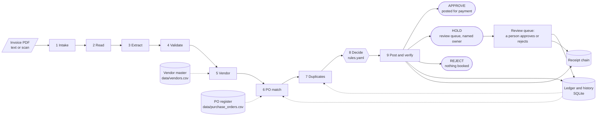
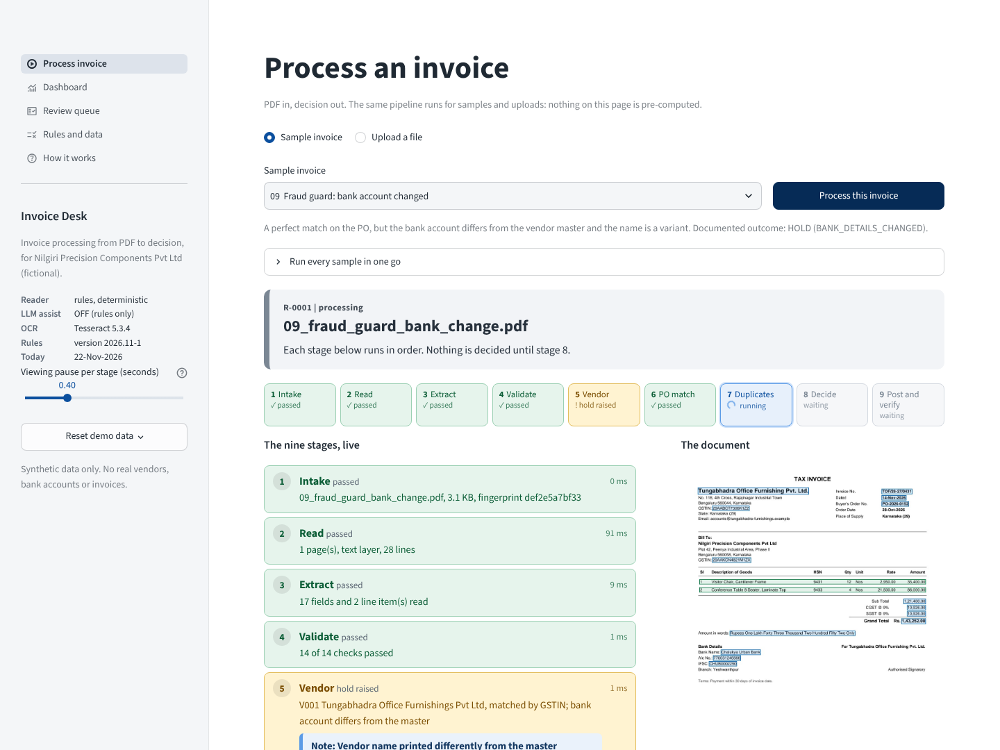
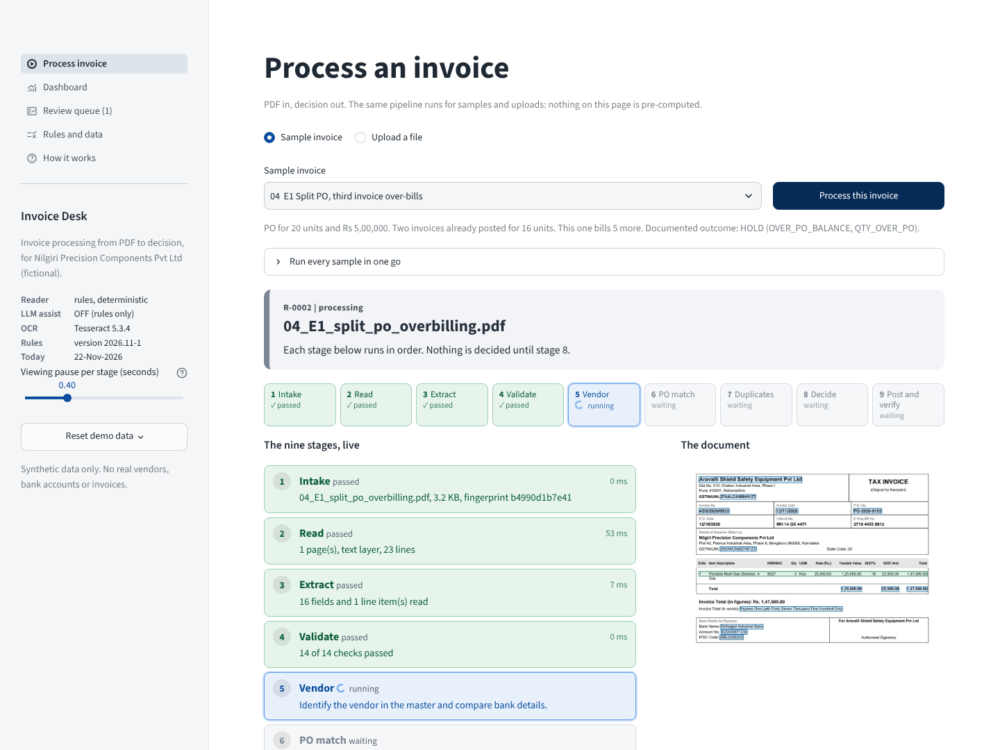
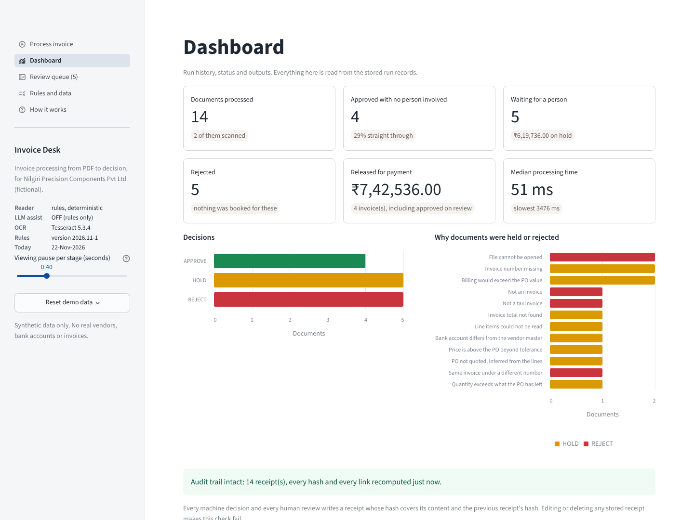

# Invoice Desk

**Invoice processing, from PDF to decision.** Problem statement 1 of the AI Solutions
Analyst case study.

A vendor invoice goes in as a PDF, text or scanned. A decision comes out: **approve**
for payment, **hold** for a named person with one specific question, or **reject**.
Every step in between is on screen with the evidence it used, and every decision leaves
a receipt that cannot be edited afterwards without it showing.

> All data in this project is synthetic. The buyer (Nilgiri Precision Components Pvt
> Ltd), the vendors, the GSTINs, the bank accounts and the invoices are fictional, and
> every PDF says so in its footer.

## Run it

```powershell
py -3.11 -m venv .venv
.venv\Scripts\python -m pip install -r requirements.txt
.venv\Scripts\python -m streamlit run app.py
```

Then open <http://localhost:8501>. On macOS or Linux use `.venv/bin/python` instead.
The full Windows walkthrough (tests, the optional OCR engine, an optional API key, free
public hosting, the demo-day checklist) is in [SETUP_WINDOWS.md](SETUP_WINDOWS.md).

Three commands worth knowing:

```powershell
.venv\Scripts\python -m pytest                       # the test suite
.venv\Scripts\python -m scripts.preflight            # is everything ready for a demo?
.venv\Scripts\python -m invoice_desk.run --all       # every sample from the command line
```

No API key, no account and no network are needed to run it. Nothing on the critical
path depends on a paid service being up.

## The problem, in one paragraph

An AP team gets hundreds of invoices a month as PDFs. Someone opens each one, finds the
purchase order in a spreadsheet, checks the numbers and decides what to do. The
invoices are messy: every vendor formats them differently, some are scans, tax may be
inside the prices or separate, the PO may be quoted or only implied, and sometimes the
invoice number is simply missing. The expensive mistakes are the quiet ones: paying
twice, paying more than was ordered, paying into the wrong bank account.

## What the process does



| # | Stage | What it does | What it leaves on screen |
|---|---|---|---|
| 1 | Intake | Registers the file and fingerprints it (SHA-256) | File, size, fingerprint, time received |
| 2 | Read | Gets the words off the page: the text layer, or straighten the scan and OCR it twice | Per page: how it was read, the tilt removed, OCR confidence |
| 3 | Extract | Finds header fields and line items, each with where it was read | Every field with value, confidence and source; line items; for scans, the two reads side by side |
| 4 | Validate | Checks the invoice against itself: required fields, arithmetic, GST, dates | 14 named checks, each pass or fail with the figures |
| 5 | Vendor | Identifies the vendor by GSTIN and compares the bank account with the master | Who matched and how; master account against invoice account |
| 6 | PO match | Finds the PO, compares line by line with tolerances, checks what earlier invoices used up | Line-by-line comparison; the running total on the PO, invoice by invoice |
| 7 | Duplicates | Looks for the same invoice already on record, in any disguise | Three checks and what each found |
| 8 | Decide | Applies `rules.yaml` to everything found | Each finding, its action, its owner |
| 9 | Post and verify | Writes the ledger, reads it back, chains a receipt | Ledger entry, read-back result, receipt hash |

## What is on screen

- **Process invoice.** Pick a sample or upload a PDF. The nine stages run one after
  another: waiting, running, done, each with its one-line result, its real timing and
  any finding it raised. The document sits beside them with a box drawn around every
  value that was read. The decision appears at the top with its reasons, the owner of
  each, the question to answer and a drafted note to the vendor when the vendor has to
  act.
- **Dashboard.** Counts and values (processed, approved with no person involved,
  waiting, rejected, released for payment, processing time), decisions and reasons as
  charts, the audit-trail check, the run history with filters, and the full record of
  any run: stages, evidence, document, receipts, downloads.
- **Review queue.** Invoices on hold, oldest first, each with its question. A named
  person approves or rejects; that decision is written into the same audit trail.
- **Rules and data.** The decision table, the tolerances, a what-if sandbox that reruns
  a sample with different thresholds, the POs with what has been billed against each,
  the vendor master and the ledger.
- **How it works.** The process on one page.

| A run in progress | A hold, with its reasons and owners |
|---|---|
|  |  |
| **Dashboard** | **Review queue** |
|  |  |

## How a decision is made

Stages 4 to 7 do not decide anything. They produce **findings**: a code, what was
expected, what was found, the evidence, and the question it raises. Stage 8 looks each
code up in [`rules.yaml`](rules.yaml), which says whether that finding rejects, holds
or is only noted, and who owns it. The strictest action wins.

```
decision = decide(findings, rules)        # no file, no database, no clock, no model
```

`decide()` is a pure function, so the same findings and the same rules always give the
same decision, and every threshold is tested from both sides. Policy lives in the rules
file: change a number there and behaviour changes with no code edit. The file's hash is
written into every receipt.

| Rule | Default | Why |
|---|---|---|
| Unit price over the PO | passes only inside **both** 1% and Rs 500 on the line | A percentage alone lets a large line drift by thousands; a rupee limit alone lets a small line double |
| Quantity over the PO | not allowed, counting what earlier invoices billed | This is what catches a split PO being over-billed |
| Cumulative billing over the PO value | passes only inside both 0.5% and Rs 500 | Same reason, at PO level |
| Invoice arithmetic | may be off by Rs 1 | Rounding |
| Clean invoice above Rs 10,00,000 | held for the finance controller | A simple delegation of authority |
| Same file again, or same number as a booked invoice | reject | Nothing can be owed twice |
| Same vendor, amount and lines under a new number within 15 days | reject if the PO has no room left; otherwise hold and ask | A repeat delivery is legitimate; a re-keyed copy is not |
| Bank account differs from the vendor master | hold, and approval needs a confirmed call-back | The classic payment-redirection pattern |
| PO not quoted on the invoice | the best-fitting PO is suggested and a person confirms | Posting against the wrong PO corrupts its balance for every later invoice |

Every text a person reads (the explanation, the question, the vendor note) is a
template filled with the evidence. No model writes it, so it is reproducible word for
word.

## The four edge cases

Each one comes from a difficulty the brief names, and each ends differently.

| | Sample | What happens | Decision |
|---|---|---|---|
| **E1** Split PO, over-billed | `04_E1_split_po_overbilling` | The PO is for 20 gas detectors and Rs 5,00,000. Two earlier invoices billed 16. This one bills 5 more. Nothing is wrong with the invoice on its own; only the running total shows it. | **HOLD**: quantity and value over the PO, with the running total and a question for the PO owner |
| **E2** Disguised duplicate | `05_E2_disguised_duplicate` | Same vendor, lines and amount as an invoice booked two days earlier, under a new invoice number. An exact-match duplicate check would pass it. | **REJECT**, pointing at the original |
| **E3** Scan, number missing, PO implied | `06_E3_scan_no_number_implied_po` | A tilted, noisy scan with no text layer. The invoice number box is blank and no PO is quoted. | **HOLD**: the blank is not filled in by guesswork; the PO is inferred with its score and a person confirms |
| **E4** Tax inside the prices, at the tolerance edge | `07_E4a...` and `08_E4b...` | Prices include GST; the PO is before tax. After conversion one invoice is Rs 3.39 over the PO price, the other Rs 50 over. | **APPROVE** with a note on one side of the tolerance, **HOLD** on the other |

Also handled, with samples or tests: a changed bank account (`09_fraud_guard_bank_change`),
an invoice written as a letter that the rules cannot read (`10_ai_assist_letter_invoice`),
quotations and unrelated PDFs, corrupt and empty files, item tables that run over
several pages, a foreign-currency invoice, a corrected copy of an invoice that is still
on hold, billing ahead of goods receipt, a lump-sum invoice against an itemised PO, an
unknown or blocked vendor, and an invoice whose own figures do not add up.

## How the reading works

- **Text PDFs** are read from their text layer with positions. Fields are found by
  label vocabulary and page geometry, not by per-vendor templates. Line items are read
  by column, and arithmetic is the cross-check: quantity times price must equal the
  amount, the lines must sum to the taxable value, taxable plus tax must equal the
  total, and the amount in words must agree with the figures.
- **Scans** are straightened, cut into blocks and read with Tesseract, **twice**: once
  from the greyscale picture and once in pure black and white. The read whose figures
  add up is used. A value that no arithmetic can confirm, such as the invoice number or
  the date, is trusted only when both reads agree; a disagreement holds the invoice.
- **Missing stays missing.** A field that cannot be read is empty with a reason. There
  are no defaults and no nearest guesses.
- **An LLM is optional and never trusted.** When the rules leave a required field or
  the item table empty and a key is configured, one call asks a model for the fields
  with a word-for-word quote for each. A value is accepted only if the quote is on the
  page, letter for letter and digit for digit, and the value is stated in that quote.
  Accepted values never overwrite what the rules read. The response is recorded so the
  same run can be replayed with no network. The model never sees the PO register and
  takes no part in the decision.

## How I know it works

- **Tests.** 364 automated tests: every rule from both sides of its threshold,
  the pure decision function (including a check that adding a problem can never make
  the outcome more lenient), the receipt chain (an edit, a forged hash and a deletion
  are each detected), every sample end to end, bad inputs that must fail gracefully
  (corrupt, empty, password-protected, oversized, 25 pages, random bytes, a page with
  absurd dimensions), the LLM path through a stub, and the UI driven headlessly.
- **A scorecard on layouts the reader was not built on.**
  [`docs/extraction_scorecard.md`](docs/extraction_scorecard.md) is generated by
  `python -m scripts.evaluate_extraction --full --write`. It creates invoices with
  random layouts, labels, date formats and amounts, adds a matching PO, and runs the
  whole pipeline. Each invoice is correct, so the right outcome is always approve.

  | Set | Documents | Approved untouched | Held although read correctly | Misread and held | Misread and approved ("silent") |
  |---|---|---|---|---|---|
  | Text PDFs, seen while building | 60 | 60 | 0 | 0 | 0 |
  | Text PDFs, held out | 140 | 140 | 0 | 0 | 0 |
  | Scanned PDFs, seen while building | 24 | 24 | 0 | 0 | 0 |
  | Scanned PDFs, held out | 72 | 64 | 3 | 5 | 0 |

  "Silent" is a misread that was approved, the outcome that costs money. These are
  synthetic scans; real ones vary more, and the file lists every misread value.
- **A preflight.** `python -m scripts.preflight` runs every sample through the real
  pipeline and compares each decision with the documented one.

## What was verified, and what was not

| Verified in the build environment | Not verified |
|---|---|
| Clean unzip, fresh install with pip, full test suite, on Linux with Python 3.11, 3.12 and 3.13 | Running on Windows (the steps are standard; do them once before the day) |
| All 14 samples from the command line and through the UI | Deployment to a public host |
| Every page in a real Chrome browser, with screenshots reviewed | The Dockerfile (written, never built) |
| Live OCR with Tesseract 5.3.4, and the recorded-OCR fallback | A live LLM call: no model was reachable, so that path is tested through a stub and `fixtures/llm/` ships empty |

## Limits

- Built for Indian GST tax invoices in English and rupees, one purchase order per
  invoice. A foreign-currency invoice is read and handed to a person.
- An invoice with no table at all (sample 10) is held by the rules alone. It needs the
  LLM assist, which needs your key and a recording (SETUP_WINDOWS.md, step 6).
- Scan quality matters. Misreads on the test scans were all caught by a check, but an
  invoice number that both reads get wrong in the same way would pass.
- A Rs 1 rounding allowance and percentage tolerances are example policy, not advice.
- The vendor master and PO register are CSV files. The ledger is a local SQLite file
  that the hosted demo rebuilds whenever the host restarts.
- No mailbox is connected: the upload box stands in for the email attachment.

## What I would build next

1. **Mailbox intake**: poll an AP inbox, take each PDF attachment, reply from the
   drafted vendor note after a person approves the wording.
2. **E-invoice checks**: read the IRN and QR code and verify them against the
   government portal, which makes the invoice number and total independent of OCR.
3. **Credit and debit notes** applied to the invoice they refer to; invoices that span
   several POs.
4. **An approval matrix** by amount and department instead of one ceiling.
5. **ERP connectors** in place of the two CSV loaders, and posting to the ERP instead
   of the local ledger.
6. **Learning from review**: when the same question is answered the same way for a
   vendor several times, propose a rule change to the process owner.

## Repository map

```
app.py                     the Streamlit app (pages only display; the work is in invoice_desk/)
rules.yaml                 every threshold and every decision, as data
invoice_desk/
  reader.py                PDF to lines: text layer, or deskew + block segmentation + OCR
  extract.py               lines to fields and line items, with sources and confidence
  second_read.py           reconciling the two reads of a scan
  validate.py              stage 4: the invoice against itself
  vendor.py                stage 5: identity and bank details
  po_match.py              stage 6: PO, tolerances, running balance
  duplicates.py            stage 7: three tiers of duplicate control
  decide.py                stage 8: the pure decision function
  pipeline.py              the nine stages, one event per stage for the live view
  store.py                 SQLite: runs, ledger, receipt chain, reviews
  review.py                human decisions on held invoices
  llm.py                   optional LLM assist: ask, verify against the page, record, replay
  ui/                      the five pages
data/                      vendor master, PO register, prior invoice history (CSV)
samples/                   10 invoices, 4 bad inputs, ground truth, manifest of expected decisions
fixtures/ocr/              recorded OCR output for the two bundled scans
fixtures/llm/              recorded model responses (empty until you record with your key)
scripts/                   test data generator, preflight, scorecard, fixture recorders
tests/                     the test suite
docs/extraction_scorecard.md   generated scorecard
docs/screenshots/          four pictures of the app, used above
RESEARCH.md PLAN.md DECISIONS.md PROGRESS.md      how it was thought through and built
SETUP_WINDOWS.md DEMO_SCRIPT.md INTERVIEW_PREP.md  how to run, show and defend it
```

## Credits

- Three earlier projects of mine supplied ideas, not code or data:
  **[ef-recon](https://github.com/hariom-s27/ef-recon)** (exact-key duplicate
  fingerprints, and the policy of escalating instead of forcing a match),
  **[controlplane](https://github.com/hariom-s27/controlplane)** (a pure `decide()`
  over findings and rules, hashed receipts, a frozen demo clock) and
  **[outcome](https://github.com/hariom-s27/outcome)** (accepting model output only
  when its quote is found in the source).
- Open-source software: Streamlit, pdfplumber, pypdfium2, Tesseract OCR and
  pytesseract, Pillow, NumPy, RapidFuzz, pydantic, PyYAML, Altair, ReportLab, pytest.
- Research sources are listed with links in [RESEARCH.md](RESEARCH.md).
- Built with an AI coding assistant, as the case study invites. Every design choice is
  written down in [DECISIONS.md](DECISIONS.md) so that it can be explained and
  challenged.
- No Zamp or Pace product is used anywhere.
